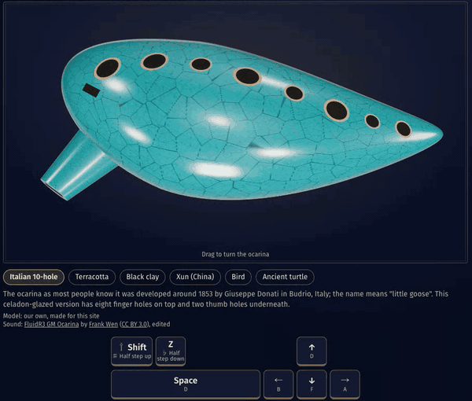
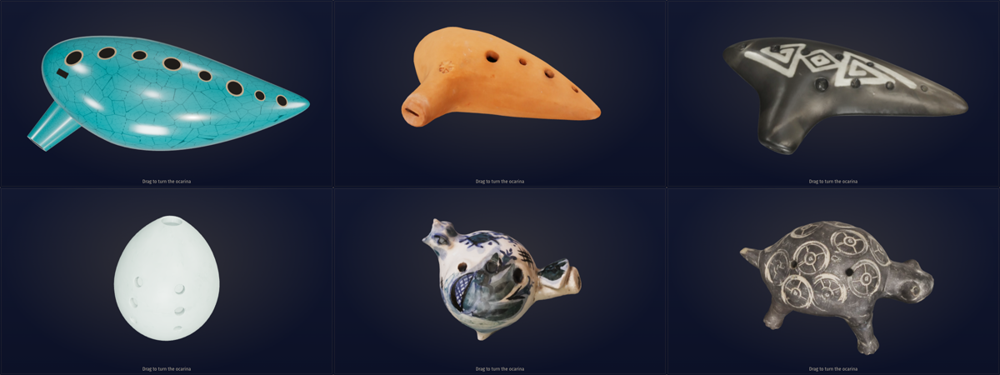
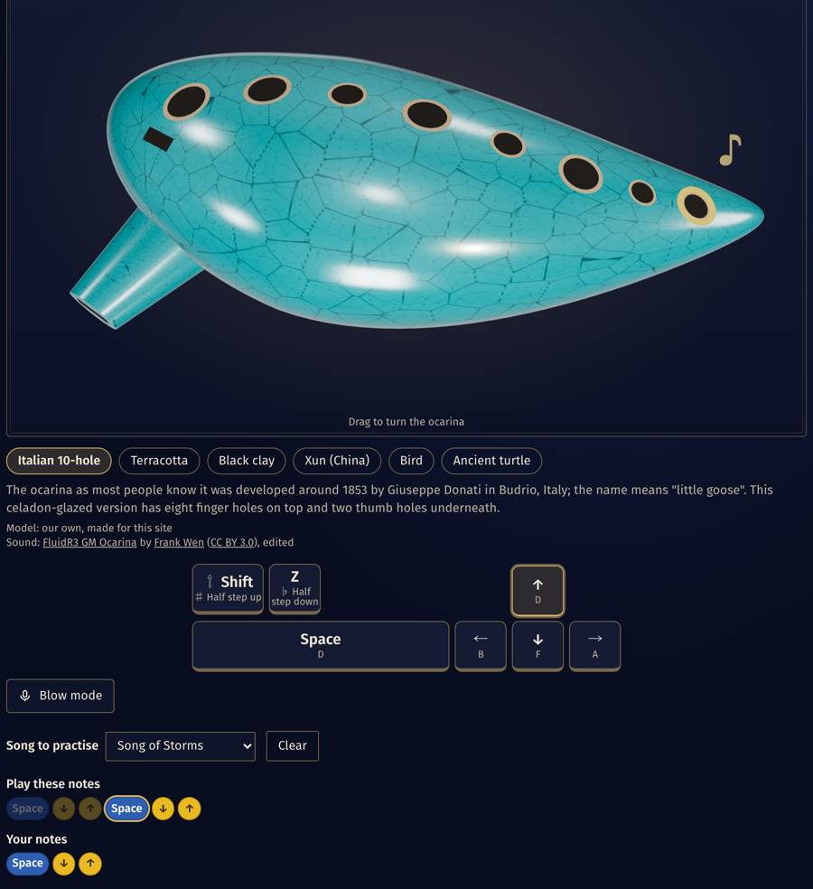
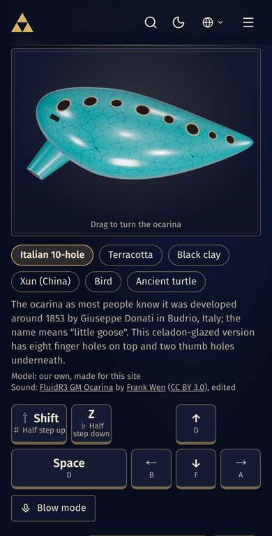
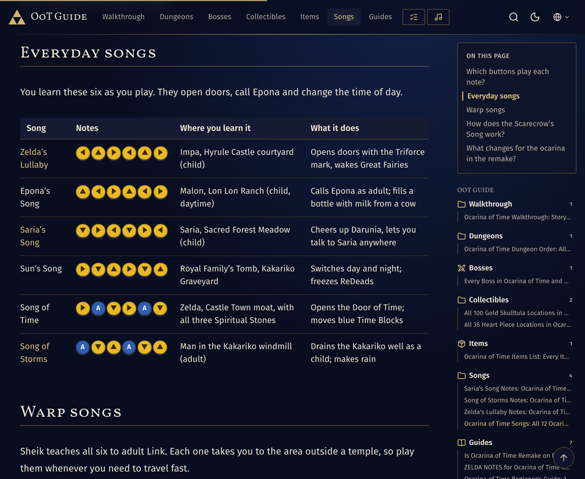

# Ocarina Simulator

A playable 3D ocarina in the browser. Play the twelve *Ocarina of Time* songs with your keyboard or by touch, switch between six real-world ocarina styles, and blow into your microphone to control the sound.

**▶ Play it live: [ootguide.com/ocarina/](https://ootguide.com/ocarina/)** (in 9 languages, with song guides)

[](https://ootguide.com/ocarina/)

Built for [OoT Guide](https://ootguide.com/), an unofficial guide to *Ocarina of Time* Remake for Nintendo Switch 2.

## Features

- **Six ocarinas, six sounds**: a procedural Italian 10-hole ocarina plus five CC BY 3D scans (terracotta, Chilean black clay, Chinese xun, bird, pre-Columbian turtle). Each has its own voice: looped recordings re-pitched from the nearest sample, or a Web Audio synth tuned to the instrument.
- **Song recognition**: play any of the twelve songs and the simulator names it. Practice mode walks you through a song note by note.
- **Keyboard and touch**: arrow keys and Space for the five notes (like the N64 C buttons and A), Shift and Z for a half step up or down. On touch screens, slide a finger across the keys.
- **Blow mode**: optional microphone input. Blow harder for a louder, slightly sharper note, like a real ocarina. Taps on the screen don't count as breaths, and talking needs to be much louder than a breath to sound. Audio is analysed in the browser and never recorded or sent.
- **Fingering on the model**: the 3D ocarina lights the open holes and shows covered ones for each note.
- No framework, no game assets: TypeScript, three.js and the Web Audio API.



## Screenshots

| Practice mode | On a phone |
| --- | --- |
| [](https://ootguide.com/ocarina/?song=song-of-storms) | [](https://ootguide.com/ocarina/) |

Practice mode lights the next note on the model and the keys. Link to `?song=<id>` (for example [`?song=song-of-storms`](https://ootguide.com/ocarina/?song=song-of-storms)) to open the simulator straight into practice for that song.

The simulator is part of [OoT Guide](https://ootguide.com/), where every song also has its notes for N64, 3DS and Switch 2, where to learn it and what it does: see [all Ocarina of Time songs](https://ootguide.com/songs/ocarina-songs/).

[](https://ootguide.com/songs/ocarina-songs/)

## Run it locally

Requires Node 20.19+ and pnpm (npm works too).

```bash
pnpm install
pnpm dev        # http://localhost:5173
pnpm build      # static files in dist/, deploy anywhere
pnpm test
```

## Code map

| File | What it does |
| --- | --- |
| `src/ocarina/synth.ts` | `OcarinaSynth`: sample and synth voices, glide between notes, vibrato, breath noise, room reverb, success chime |
| `src/ocarina/scene.ts` | `createOcarinaScene`: three.js scene, procedural ocarina, GLB loading, hole highlights and note particles |
| `src/ocarina/styles.ts` | The six ocarina styles: models, hole positions, fingerings, sounds and credits |
| `src/ocarina/breath.ts` | `BreathInput`: microphone input, iOS audio session, low-band level and spectrum every frame |
| `src/ocarina/breath-detector.ts` | `BreathDetector`: decides what counts as a breath (sustained low-frequency noise above the room; taps are ignored, voices and music need to be much louder) |
| `src/ocarina/matcher.ts` | Song recognition and practice-mode progress |
| `src/songs.ts` | The twelve songs as note sequences |
| `src/main.ts` | The page: keyboard, touch, practice mode, style picker |

The `src/ocarina/` modules have no dependency on the page, so you can drop them into another project:

```ts
import { OcarinaSynth } from './ocarina/synth';
import { OCARINA_STYLES } from './ocarina/styles';

const synth = new OcarinaSynth();
await synth.setSound(OCARINA_STYLES[0].sound);
synth.noteOn('A'); // D4, the A button
```

## Credits and license

Source code: MIT, see [LICENSE](LICENSE). 3D models and recordings are Creative Commons (CC BY or CC0) and listed with their authors in [ASSETS.md](ASSETS.md); keep those credits if you reuse them.

If you use this project, a link back to **[ootguide.com/ocarina/](https://ootguide.com/ocarina/)** is appreciated.

Fan-made and unofficial. No game audio or artwork is used. Not affiliated with or endorsed by Nintendo. *The Legend of Zelda* and *Ocarina of Time* are trademarks of Nintendo.
